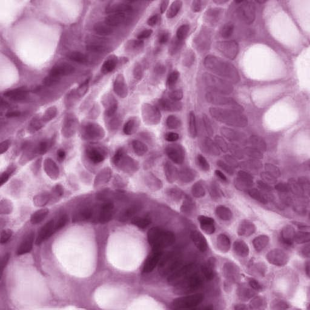
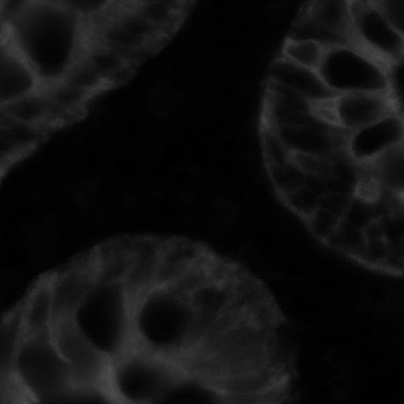
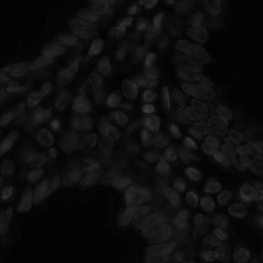

# H&E ↔ DAPI Bidirectional Virtual Staining

[](https://github.com/urbiologicalpa/he-dapi-translator/actions)
[](#status)
[](LICENSE)
[](pyproject.toml)
[](https://pypi.org/project/he-dapi/)
[](#limitations)

Product scaffold for a **bidirectional H&E ↔ DAPI virtual staining tool**: one
plugin/API/UI where a user can drop either modality and request the other, on
patches or whole-slide images.

**The bidirectional product is not available yet.** Only a one-way forward
baseline is being trained; the reverse direction is still a skeleton. This repo
does not claim a working bidirectional model until both directions have trained,
evaluated weights. The product thesis is the unified workflow, not another
one-way H&E → DAPI paper reproduction.

> **Important status (2026-10-20).** A channel-order bug in the previous data
> pipeline trained the current checkpoints on **panCK (ch2)**, not DAPI (ch0).
> The public weights and the epoch-199/200 run are therefore an H&E → panCK
> ablation, **not a DAPI model**. The data builder and loader are fixed; the
> corrected DAPI model is the next training milestone. Do not use the current
> weights as a DAPI solution. See [Results](#results) and
> [`docs/MODEL_CARD.md`](docs/MODEL_CARD.md).

## Contents

- [Status](#status)
- [Why bidirectional](#why-bidirectional)
- [What is implemented](#what-is-implemented)
- [Data](#data)
- [Quick start](#quick-start)
- [Training](#training)
- [Inference](#inference)
- [Results](#results)
- [Repository layout](#repository-layout)
- [Roadmap](#roadmap)
- [Limitations](#limitations)
- [Citation](#citation)
- [License](#license)

## Status

| Area | State | Notes |
|---|---|---|
| Bidirectional plugin / one workflow | **Not available** | UI/API routing scaffold exists; reverse model is untrained, so this is not yet a bidirectional product |
| H&E → panCK ablation | **Finishing / archive** | Local CPU run, epoch 199 saved, epoch 200 running; used only to validate the pipeline |
| H&E → DAPI | **Not trained yet** | Data fix is in place; corrected 1024px run is queued |
| DAPI → H&E | **Not available** | The CycleGAN trainer is a smoke-test skeleton; no real weights |
| Dual-branch Swin + FMF | **Not implemented** | `train_paired.py` currently builds the U-Net baseline |
| Data pipeline | **Implemented** | HEMIT 5,292 pairs; streaming 512px builder + corrected 1024px builder |
| Patch inference | **Implemented** | PyTorch + tiled 512px inference on CPU |
| WSI inference | **Experimental** | Tiled/streaming path exists; not validated at scale |
| Backend / frontend | **Alpha** | FastAPI + React drag-and-drop UI; Docker staging build |
| PyPI packages | **Alpha** | `he-dapi` / `napari-he-dapi`; current weights are the panCK ablation |

Hardware context:

- Local development/training box: **3.7 GB RAM, CPU only**.
- Corrected 1024px training target: **Kaggle Tesla T4 16 GB** (verified available).
- A full 1024px dual-branch model is not expected to fit comfortably for
  training on the 3.7 GB box; CPU deployment will use tiled inference and may
  require distillation/quantization.

## Why bidirectional

One-way H&E → DAPI is already published (HEMIT, mSIGHT, and related work). A
plain forward U-Net is a **baseline**, not the product differentiator. The gap is
a single tool that accepts either modality, routes to the right model, and
supports patch + WSI workflows with honest confidence/limitations.

That is the product thesis. The current repo is the first stage of it: fix the
data, establish a reproducible forward baseline, then train the reverse
direction, and only then expose both directions as one bidirectional plugin.

## What is implemented

### Models and losses

- **Implemented forward baseline:** a compact U-Net generator (3 → 1) with a
  PatchGAN discriminator, L1 + SSIM, optional DISTS, and a nuclei-Dice auxiliary
  loss. This is the one-way baseline, not the bidirectional product.
- **Implemented reverse trainer skeleton:** a ResNet generator and a
  CycleGAN-style dummy loop. It is not a working DAPI → H&E model yet.
- **Not implemented:** a unified bidirectional model, direction router, shared
  encoder/dual decoders, or trained reverse weights.
- **Planned:** the HEMIT dual-branch generator (CNN-ResNet + Swin-T + feature-map
  fusion) and the full paper training protocol. The config name
  `hemit_dual_branch.yaml` is aspirational; the trainer currently selects the
  U-Net baseline.

### Data and inference

- Streaming HDF5 builders that avoid loading the full dataset into RAM.
- Correct HEMIT channel handling: **ch0 = DAPI, ch1 = CD3, ch2 = panCK**.
- Optional Macenko H&E normalization at pack time.
- 512px tiled inference with overlap averaging, plus an experimental streaming
  WSI path.
- Resumable, atomic checkpoints for long CPU runs.
- FastAPI backend (`/health`, `/models`, `/translate`, `/translate/wsi`),
  React UI, and Docker staging build.

### Not implemented or not validated

- A unified bidirectional model or direction router.
- A trained DAPI → H&E direction.
- Full 1024px DAPI training.
- HEMIT dual-branch / Swin / FMF.
- Full 630-image validation and held-out test evaluation for DAPI.
- Clinical or diagnostic validation of any kind.

## Data

The primary dataset is **HEMIT** (5,292 paired 1024×1024 patches):

| Split | Pairs |
|---|---:|
| Train | 3,717 |
| Val | 630 |
| Test | 945 |

| H&E input | DAPI target (`ch0`) | panCK (`ch2`, old wrong target) |
|---|---|---|
|  |  |  |

Raw files live under `data/raw/hemit/extracted/{train,val,test}/{input,label}`.
HEMIT label TIFFs are 3-channel mIHC:

| Channel | Marker |
|---|---|
| `ch0` | **DAPI** |
| `ch1` | CD3 |
| `ch2` | panCK |

**Known data pitfall:** the old 512px H5 files (`data/processed/hemit_*_512.h5`)
were built with `ch2` as the target. They are the source of the panCK ablation
and must not be used for DAPI training or evaluation.

Build the corrected native-resolution dataset:

```bash
uv run --extra data python -m scripts.data.pack_hemit_1024 \
  --splits train val test \
  --patch-size 1024 \
  --compression gzip --compression-level 4
```

This writes `data/processed/hemit_{train,val,test}_1024.h5` with `he`, `mihc`,
and `dapi` arrays plus metadata (`dapi_channel=0`, `channel_order`, Macenko
settings). See [`docs/DATA.md`](docs/DATA.md) for details and storage estimates.

Dataset license: **CC BY 4.0** (HEMIT). Code license: **MIT**. Attribution is
required when redistributing the dataset or derived weights.

## Quick start

### Local environment

```bash
git clone https://github.com/urbiologicalpa/he-dapi-translator.git
cd he-dapi-translator

python -m venv .venv
source .venv/bin/activate
pip install -e ".[lowram]"
```

For a CPU-only PyTorch install, follow the
[PyTorch selector](https://pytorch.org/get-started/locally/) or install the CPU
wheel first, then `pip install -e ".[lowram]"`.

### Run the tests

```bash
PYTHONPATH=. python -m pytest tests -q
```

The fast CI set covers channel order, dataset fallback behavior, resource
guards, imports, and a dummy inference smoke test. Heavy dummy-training tests
are marked `slow` and run manually or weekly.

### Backend + frontend

```bash
# backend (serves src/frontend/dist when built)
PYTHONPATH=. uvicorn src.backend.main:app --host 0.0.0.0 --port 8000

# frontend dev server (separate terminal)
cd src/frontend
npm install
npm run dev
```

Docker staging build:

```bash
docker build -t he-dapi-translator -f docker/Dockerfile .
```

### PyPI packages (alpha)

```bash
pip install he-dapi
he-dapi info
he-dapi translate -i he.png -o out.png -d he2dapi
```

> The published `he-dapi` package currently resolves to the **panCK ablation**
> checkpoint. Treat its output as an H&E → mIHC-channel demo, not DAPI. The
> package will be re-released with corrected DAPI weights.

## Training

### Current CPU baseline (panCK ablation only)

```bash
PYTHONPATH=. python -m src.models.train_paired \
  --config configs/hemit_dual_branch.yaml \
  --resume auto --optimize-for lowram
```

This is a 512px, batch-2, grad-accum-4 CPU configuration. It is useful as an
engineering baseline but it is **not** the DAPI experiment.

### Corrected DAPI run (next)

The intended protocol follows the HEMIT paper:

- 1024×1024 patches, 50% overlap where applicable.
- Macenko H&E normalization.
- Adam, `lr=3e-5`, 50 epochs then linear decay (100 epochs total), `λ_L1=30`.
- No random flips; batch size 2 on a 16 GB GPU.
- Checkpoint every epoch and resume after Kaggle's 12-hour session limit.

Start with the U-Net baseline on corrected 1024px data. Add the dual-branch
generator only after the baseline has a clean, reproducible evaluation.

## Inference

Patch:

```bash
PYTHONPATH=. python src/models/infer.py \
  --input data/examples/he_example.png \
  --direction he2dapi \
  --checkpoint resources/models/checkpoints/he2dapi/generator_last.pt \
  --out /tmp/synthetic.png
```

WSI (experimental):

```bash
PYTHONPATH=. python src/models/infer.py \
  --input data/raw/wsi/CMU-1.svs \
  --direction he2dapi --wsi --stream \
  --out /tmp/wsi_synthetic.tiff
```

Current checkpoints are the panCK ablation. Corrected DAPI inference commands
will be published with the first validated DAPI checkpoint.

## Results

### DAPI target: no valid result yet

There is **no trained DAPI model** to report. The repository intentionally does
not present the old metrics as DAPI results.

Reference numbers from the HEMIT paper (DAPI column, for orientation only):

| Model | SSIM | Pearson | PSNR (dB) |
|---|---:|---:|---:|
| U-Net | 0.791 | 0.659 | 27.929 |
| Pix2Pix U-Net | 0.775 | 0.652 | 27.691 |
| Dual-branch (paper) | **0.815** | **0.716** | **28.610** |

These are paper results on HEMIT, not results from this repository. The
comparison protocol and table templates are in
[`docs/BENCHMARK.md`](docs/BENCHMARK.md).

### panCK ablation (do not read as DAPI)

The local CPU run optimized `mihc[..., 2]` (panCK). Its checkpoints,
`docs/metrics_eval.json`, and the current demo weights belong to this ablation.
On a 30-image validation subset the pipeline reached roughly **29 dB PSNR**;
that number is not comparable to the DAPI table above and is not a claim of
DAPI quality. See [`docs/RESULTS.md`](docs/RESULTS.md) for the full explanation.

## Repository layout

```
configs/                  training configs (CPU baseline + planned 1024 DAPI)
scripts/data/             dataset builders (HEMIT 512/1024, BCI, extraction)
scripts/kaggle/           Kaggle GPU training helper
src/models/               datasets, losses, trainers, inference, evaluation
src/utils/                resource monitor, tiling, WSI loader, stain norm, tracker
src/backend/              FastAPI inference server
src/frontend/             React drag-and-drop UI
packages/                 PyPI packages: he-dapi, napari-he-dapi
resources/                dataset scripts, model cards, papers, checkpoints
docs/                     data, model card, results, deployment, tracker
tests/                    channel, dataset, resource-guard, import, smoke tests
docker/                   multi-stage image + compose
```

Generated artifacts are git-ignored:

- `data/raw/`, `data/processed/`
- `resources/models/checkpoints/`
- `*.h5`, `*.pt`, `*.onnx`
- logs, profiles, and local tokens

## Roadmap

- [x] Stream HEMIT into resumable HDF5 without OOM on a 3.7 GB box.
- [x] Identify and fix the DAPI channel-order bug (`ch0`, not `ch2`).
- [x] Add channel-order regression tests and a corrected 1024px builder.
- [x] Confirm Kaggle T4 availability and the free GPU quota path.
- [ ] Archive the panCK ablation and publish full 630/945 benchmark numbers.
- [ ] Build and verify corrected 1024px HEMIT HDF5.
- [ ] Train corrected U-Net H&E → DAPI baseline on 1024px data.
- [ ] Run the full 630-image validation and 945-image held-out test evaluation.
- [ ] Implement/vendor the dual-branch Swin-T + FMF generator.
- [ ] Train DAPI → H&E (paired if aligned data is available; otherwise unpaired).
- [ ] Add a direction router so one plugin/API accepts either modality.
- [ ] Benchmark 512px tiled / INT8 CPU inference against the 3.7 GB target.
- [ ] Ship **bidirectional v1** only after both directions have trained, evaluated
      weights; until then this is a one-way research preview.
- [ ] Publish model cards with intended use, limits, and failure modes.

## Limitations

- **Not for clinical use.** Outputs are synthetic research images and have not
  been reviewed by pathologists or validated for diagnosis.
- **Not bidirectional yet.** The UI/API scaffold is bidirectional in intent, but
  only a forward trainer exists; there is no trained reverse model or unified
  router.
- **Current weights are panCK, not DAPI.** The channel-order correction
  invalidates the old demo and metrics for DAPI.
- **No reverse model.** DAPI → H&E is a placeholder, not a trained product.
- **Architecture gap.** The config and README previously described a
  dual-branch Swin/FMF model that the trainer did not implement. The code now
  documents the U-Net baseline explicitly; the dual-branch is still planned.
- **Small validation only.** The available metrics use 30 validation images,
  not the full 630-image split.
- **CPU limits.** Full 1024px inference/training does not fit comfortably on
  3.7 GB RAM. Deployment will require tiled inference and likely quantization
  or distillation.
- **Dataset scope.** HEMIT is same-slide aligned mIHC data; performance on other
  scanners, stains, tissues, and misaligned sections is unknown.

## Citation

If you use the HEMIT dataset or the dual-branch method, cite the original work:

```bibtex
@inproceedings{bian2024hemit,
  title     = {HEMIT: H\&E to Multiplex-immunohistochemistry Image Translation
               with Dual-Branch Pix2pix Generator},
  author    = {Bian, Chang and others},
  booktitle = {MICCAI Workshop on Multiscale Multimodal Medical Imaging (MMMI)},
  year      = {2024},
  eprint    = {2403.18501},
  archivePrefix = {arXiv}
}
```

Dataset: [BianChang/HEMIT-DATASET](https://github.com/BianChang/HEMIT-DATASET)
(CC BY 4.0). Reference implementation:
[BianChang/Pix2pix_DualBranch](https://github.com/BianChang/Pix2pix_DualBranch)
(MIT).

If you use this software, cite it via [`CITATION.cff`](CITATION.cff).

## License

Code: **MIT** (see [`LICENSE`](LICENSE)). HEMIT data: **CC BY 4.0**. Model
weights derived from HEMIT inherit the dataset's attribution requirements.
Nothing in this repository is a medical device or a clinical decision support
system.

## Contributing

See [`CONTRIBUTING.md`](CONTRIBUTING.md) and [`CODE_OF_CONDUCT.md`](CODE_OF_CONDUCT.md).
Good first issues are labeled on GitHub. Please do not open PRs that present the
panCK ablation as a DAPI result.

## Author

**Bikash Kumar** ([@urbiologicalpa](https://github.com/urbiologicalpa)) —
Python / ML / computational biology. Open to collaboration on virtual staining,
digital pathology, and low-resource ML.
